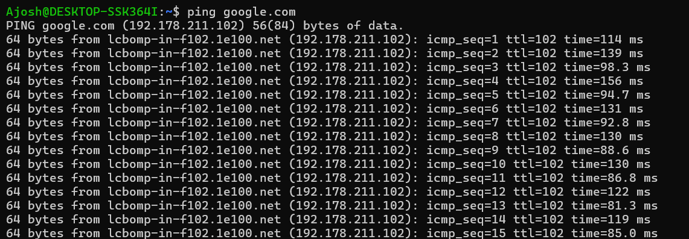
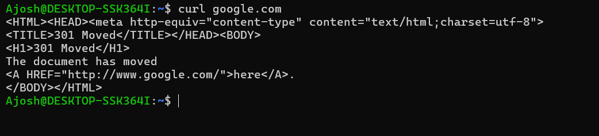
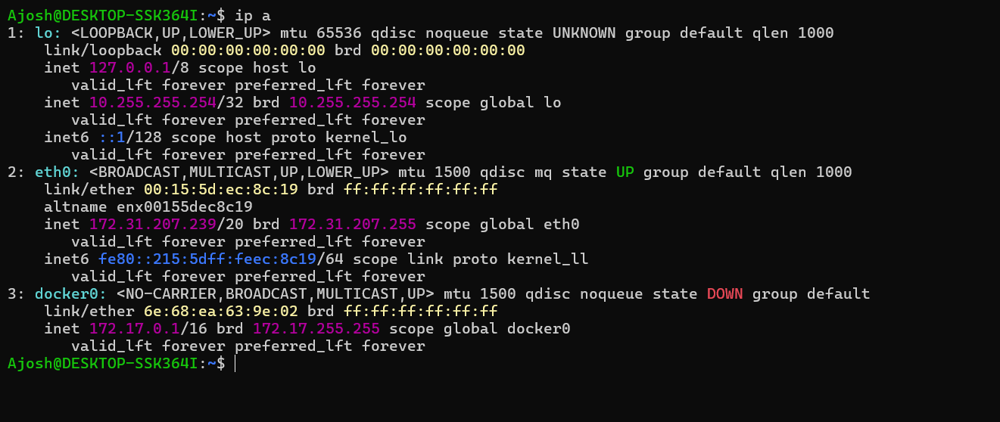
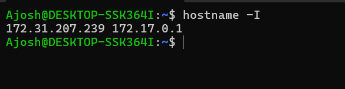
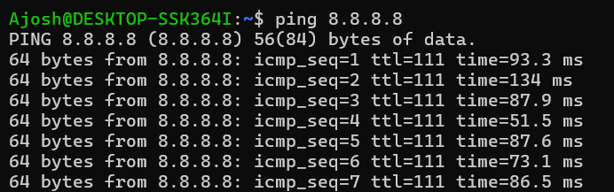
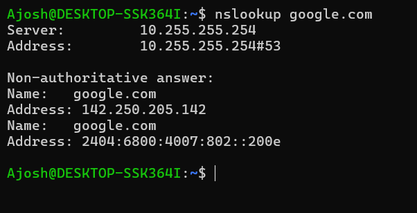
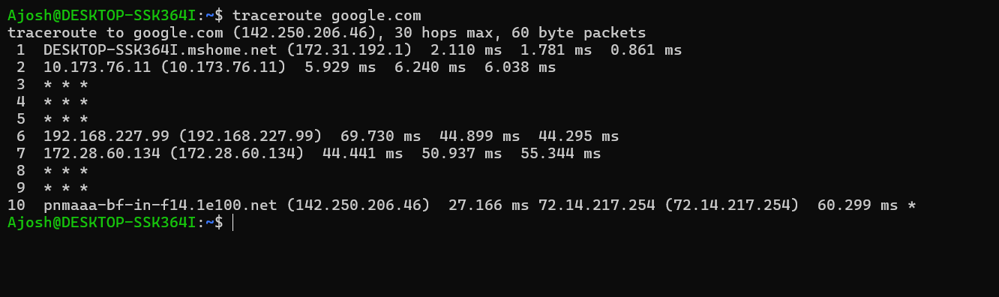

# Week 3 – Networking Machine Test
Name - Ajosh
Batch- 9:15-10:15 pm

## Theory Tasks

### 1. What is Networking?
Networking is the practice of connecting two or more computing devices (computers, servers, phones, routers, IoT devices) so they can exchange data and share resources such as files, printers, and internet access. It relies on hardware (cables, switches, routers, network cards) and software (protocols such as TCP, IP, HTTP, DNS) that define how data is formatted, addressed, sent, and received.

### 2. Explain LAN, WAN, and Internet

| Term | Full Form | Description | Example |
|------|-----------|-------------|---------|
| **LAN** | Local Area Network | A network covering a small geographic area such as a home, office, or school. High speed, low latency, privately owned. | Office Wi-Fi, home network |
| **WAN** | Wide Area Network | A network spanning a large geographic area (cities, countries) by connecting multiple LANs, usually via leased lines or ISPs. | A company linking its branch offices across countries |
| **Internet** | Interconnected Networks | A global public network of networks (LANs, WANs, and more) connected using the TCP/IP protocol suite. It is the largest WAN. | Websites, email, streaming |

### 3. What is the OSI Model?
The **OSI (Open Systems Interconnection) Model** is a conceptual framework created by ISO that standardizes how different network systems communicate. It splits the communication process into **7 layers**, each with a specific responsibility, so that vendors can build interoperable products and engineers can troubleshoot problems layer by layer.

### 4. Explain the 7 Layers of the OSI Model

| # | Layer | Function | Examples / Protocols / Devices |
|---|-------|----------|-------------------------------|
| 7 | **Application** | Interface between the user/application and the network; provides network services. | HTTP, HTTPS, FTP, SMTP, DNS, SSH |
| 6 | **Presentation** | Translates, encrypts/decrypts, and compresses data so the receiver can understand it. | SSL/TLS, JPEG, ASCII, MPEG |
| 5 | **Session** | Establishes, manages, and terminates sessions (connections) between applications. | NetBIOS, RPC, session tokens |
| 4 | **Transport** | End-to-end delivery, segmentation, flow control, error recovery, port addressing. | TCP, UDP |
| 3 | **Network** | Logical addressing and routing of packets between networks. | IP, ICMP, routers |
| 2 | **Data Link** | Node-to-node delivery within the same network, MAC addressing, framing, error detection. | Ethernet, MAC, switches, ARP |
| 1 | **Physical** | Transmission of raw bits over a physical medium (electrical, light, radio signals). | Cables, hubs, Wi-Fi radio, NIC |

*Memory trick (top to bottom):* **A**ll **P**eople **S**eem **T**o **N**eed **D**ata **P**rocessing.

### 5. What is the TCP/IP Model?
The **TCP/IP Model** (Internet Protocol Suite) is the practical protocol model on which the modern internet runs. It was developed by the US Department of Defense and has **4 layers**:

1. **Application Layer** – HTTP, HTTPS, FTP, SMTP, DNS, SSH
2. **Transport Layer** – TCP, UDP (reliable or fast end-to-end delivery)
3. **Internet Layer** – IP, ICMP, ARP (addressing and routing)
4. **Network Access (Link) Layer** – Ethernet, Wi-Fi, device drivers (physical transmission)

### 6. Difference between OSI and TCP/IP

| Feature | OSI Model | TCP/IP Model |
|---------|-----------|--------------|
| Layers | 7 | 4 (sometimes described as 5) |
| Nature | Theoretical / reference model | Practical, implemented model |
| Developed by | ISO | US DoD (ARPANET) |
| Approach | Protocol-independent, generic | Built around specific protocols (TCP, IP) |
| Layer merging | Separate Application, Presentation, Session layers | Combined into one Application layer |
| Lower layers | Separate Data Link and Physical layers | Combined into Network Access layer |
| Usage | Teaching, troubleshooting, standardization | Real-world internet communication |
| Reliability | Both connection-oriented and connectionless at the network layer | Connectionless at Internet layer; both at Transport |

**Layer mapping:**

| OSI | TCP/IP |
|-----|--------|
| Application, Presentation, Session | Application |
| Transport | Transport |
| Network | Internet |
| Data Link, Physical | Network Access |

### 7. What is an IP Address?
An **IP (Internet Protocol) address** is a unique numerical identifier assigned to every device on a network. It serves two purposes: identifying the device (host) and indicating its location in the network so data can be routed to it.

- **IPv4:** 32-bit, written as four decimal numbers (e.g., `192.168.1.10`), about 4.3 billion addresses.
- **IPv6:** 128-bit, written in hexadecimal (e.g., `2001:0db8::1`), a vastly larger address space.

### 8. What is DNS?
**DNS (Domain Name System)** is the "phonebook of the internet". It translates human-friendly domain names (e.g., `google.com`) into machine-readable IP addresses (e.g., `142.250.x.x`). When you enter a domain, your system queries a DNS resolver, which may ask root, TLD, and authoritative name servers until it finds the IP. DNS uses port **53** (UDP/TCP). Common record types: A, AAAA, CNAME, MX, NS, TXT.

### 9. What is ICMP?
**ICMP (Internet Control Message Protocol)** is a network-layer protocol used by devices to send error messages and operational/diagnostic information (e.g., "destination unreachable", "time exceeded"). It does not carry application data. Tools such as **ping** (Echo Request/Echo Reply) and **traceroute** rely on ICMP to test connectivity and discover paths.

### 10. Why is Networking Important in DevOps?
- **Connectivity between services:** Microservices, databases, load balancers, and APIs communicate over networks.
- **CI/CD pipelines:** Pulling code from Git, pushing images to registries, and deploying to servers all require reliable networking.
- **Cloud and infrastructure:** Configuring VPCs, subnets, security groups, firewalls, and routing is core to AWS/Azure/GCP.
- **Containers and orchestration:** Docker networking and Kubernetes services/ingress depend on networking concepts.
- **Troubleshooting:** Tools like `ping`, `curl`, `nslookup`, and `traceroute` help diagnose latency, DNS, and connectivity issues quickly.
- **Security:** Understanding ports, protocols, and firewalls helps secure applications and limit attack surface.
- **Performance and scalability:** Load balancing, CDNs, and DNS routing improve availability and speed.
- **Monitoring:** Network metrics (latency, packet loss, bandwidth) are key signals for observability.

---

## Practical Tasks

> Run each command in your terminal, take a screenshot of the output, and add it below.

### 1. `ping google.com`
```
(paste output here)
```


### 2. `curl google.com`
```
(paste output here)
```


### 3. `ip a`
```
(paste output here)
```


### 4. `hostname -I`
```
(paste output here)
```


### 5. `ping 8.8.8.8`
```
(paste output here)
```


### 6. `nslookup google.com`
```
(paste output here)
```


### 7. `traceroute google.com`
```
(paste output here)
```


---

## Explain the Following Commands

### 1. What does `ping` do?
`ping` tests whether a host is reachable over an IP network and measures round-trip time. It sends **ICMP Echo Request** packets to the target and waits for **Echo Reply** packets. The output shows response time (latency), TTL, and packet loss. Example: `ping google.com` checks both DNS resolution and connectivity; `ping 8.8.8.8` checks connectivity without DNS. (On Linux, it runs until stopped with `Ctrl+C`; use `-c 4` to send 4 packets.)

### 2. What does `curl` do?
`curl` (Client URL) is a command-line tool for transferring data to or from a server using protocols such as HTTP, HTTPS, FTP, and more. It is used to fetch web pages, call REST APIs, download files, test endpoints, and inspect headers (`curl -I`). Example: `curl google.com` returns the HTML (often a 301 redirect response to `www.google.com`).

### 3. What does `ip a` do?
`ip a` (short for `ip address show`) displays all network interfaces on the system along with their IP addresses (IPv4 and IPv6), MAC addresses, MTU, and state (UP/DOWN). It is the modern replacement for the older `ifconfig` command. For example, `lo` is the loopback interface (127.0.0.1) and `eth0`/`ens33` is typically the main network adapter.

### 4. What does `hostname -I` do?
`hostname -I` prints all IP addresses assigned to the machine (excluding loopback), separated by spaces, with no other details. It is a quick way to find the machine's IP address, handy in scripts.

### 5. What does `nslookup` do?
`nslookup` queries DNS servers to find the IP address for a domain name (or the domain name for an IP via reverse lookup). The output shows which DNS server answered and the resulting records (A/AAAA, etc.). It is used to troubleshoot DNS issues. Example: `nslookup google.com`.

### 6. What does `traceroute` do?
`traceroute` shows the path packets take from your machine to a destination, listing each router (hop) along the way with the time taken per hop. It works by sending packets with incrementing **TTL** values; each router that decrements the TTL to zero sends back an ICMP "Time Exceeded" message, revealing its address. It helps locate where delays or failures occur in the network path.

---

## Bonus Research

### 1. Public IP Address
A **public IP address** is a globally unique address assigned by an ISP that is reachable over the internet. Devices with public IPs can be accessed from anywhere on the internet (subject to firewall rules). Example: `142.250.190.78`. Your router typically holds one public IP that represents your whole home or office network on the internet. You can check yours with `curl ifconfig.me`.

### 2. Private IP Address
A **private IP address** is used inside local networks (LANs) and is not routable on the public internet. These ranges are reserved by RFC 1918:

| Range | CIDR | Typical use |
|-------|------|-------------|
| 10.0.0.0 – 10.255.255.255 | 10.0.0.0/8 | Large enterprises, cloud VPCs |
| 172.16.0.0 – 172.31.255.255 | 172.16.0.0/12 | Medium networks, Docker default |
| 192.168.0.0 – 192.168.255.255 | 192.168.0.0/16 | Home and small office networks |

Private IPs are reused across many different networks and converted to a public IP by **NAT** (Network Address Translation) when accessing the internet.

### 3. Difference between Public IP and Private IP

| Feature | Public IP | Private IP |
|---------|-----------|------------|
| Scope | Global, internet-wide | Local network only |
| Uniqueness | Must be unique across the internet | Unique only within its own network |
| Assigned by | ISP / regional internet registries | Router / DHCP server / admin |
| Internet routable | Yes | No (needs NAT) |
| Cost | Usually paid (via ISP) | Free |
| Security | More exposed to external attacks | Hidden behind NAT/firewall, more secure |
| Examples | `8.8.8.8`, `142.250.190.78` | `192.168.1.5`, `10.0.0.12` |
| Check with | `curl ifconfig.me` | `ip a`, `hostname -I` |
